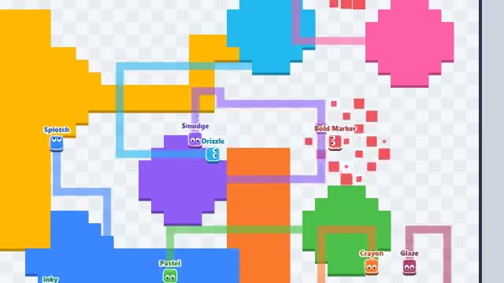

# Paint Claim

Draw a loop, claim the land. Cut their trails. A multiplayer starter game from [Multiplayer Agent](https://multiplayeragent.com): 2D, drop-in, 2–12 players, with bots that fill empty seats.

## How it plays

Leave your land and a trail follows you; get back home and everything inside the loop turns your color. Cross someone's trail to knock them out, but if anyone crosses yours, you're out.

**Controls:** Arrow keys, WASD or the mouse to turn; swipe on touch.

## Make it yours in the Game Builder

Open the [Game Builder](https://multiplayeragent.com), choose **Start from a starter game** and pick Paint Claim. It opens as version 1 in your studio, ready to play and publish. Then ask for changes, for example:

- Give everyone a speed boost while they're on their own land
- Make the map an island with water around the edges
- Add teams that share their land

## Run it yourself

1. Get a free publishable key (`pk_…`) at [multiplayeragent.com](https://multiplayeragent.com).
2. In `index.html`, put it in place of `pk_REPLACE_ME` in the `MP_CONNECT` block.
3. Open `index.html` in a browser. No build step and no server needed.

Without a key it still runs, offline against bots.

## How it is built

- One `index.html`. The comment at the top of the script maps the code and explains the multiplayer.
- **Leaderboard:** Each player's biggest share of the map, shown when you're out.
- **Host-run rules:** The host's browser fills in every loop and keeps the map; if it leaves, the next player takes over.
- **Bots:** Bots fill the map until enough people join.
- **Live sync:** Every runner and trail moves for everyone at once; whoever gets cut says so.
- `?attract` runs it offline with bots only. The preview video is recorded from it.

## License

MIT.
